<p align="center">
  
</p>

<p align="center">
  
  
  
  
  
  
</p>

<p align="center">
  
</p>

### 🐝 Welcome to the hive

Every morning in Manila, thousands of drivers open the same navigation app and get told the same thing: *this road is fastest*. So everyone takes it, and within minutes it isn't. Each driver is being perfectly rational, and together they build the jam.

**Traffic Hive** is our BSCS thesis at **Pamantasan ng Lungsod ng Maynila**, and it asks a simple question: what happens if drivers stop competing for the "best" road and start sharing the roads the city already has? We built a routing rule called the **Hive Path Distribution Mechanism (HPDM)**, tested it inside **SUMO** on the real España network, and compared it against the selfish routing that navigation apps do today. Same cars, same streets, same seed. Only the rule changes.

<br/>

<p align="center">
  
</p>

<p align="center">
  <sub>☝️ Three real corridors between the same two points on the España network. Left: everyone chases the fastest one. Right: the hive shares the load. The numbers underneath are measured in SUMO.</sub>
</p>

<p align="center">
  
</p>

### 🧠 How the hive decides

The trick is in *what* each driver is asked to pay attention to. A selfish driver looks at their own travel time. A hive driver is assigned using **marginal cost**: their own time *plus* the delay they add to everyone already on that road. That one change is the difference between a crowd and a swarm.

<p align="center">
  
</p>

<details>
<summary><b>🔍 Peek at the math</b></summary>
<br/>

We started by pricing corridors with a textbook BPR curve, and it fooled us. On signalised city streets that curve barely rises until a road is nearly full, because the real delay lives in the queues at junctions. Every driver kept seeing the same corridor as cheapest and demand piled onto it (an 83 / 15 / 2 % split on España).

So now the controller **measures** each corridor's travel time every epoch from SUMO's per-edge estimates, and derives marginal cost from that. With T − T0 = T0·β·(N/C)ⁿ:

```
MC = T0 [1 + (n+1) β (N/C)ⁿ]  =  T0 + (n+1)(T_obs − T0)
```

No capacity estimate needed. A few things keep it stable and fair:

- 📉 **Smoothing.** Measurements are weighted 0.4 on the newest to damp feedback oscillation.
- 🚦 **No herding.** Each assignment adds its expected delay n(T − T0)/N until the next measurement, so a burst of departures doesn't all land on one road.
- ⚖️ **Fairness bound ε = 0.25.** Applied to expected travel time (what a driver actually feels), not to marginal cost. Nobody gets sent somewhere more than 25 % slower than their best option.
- 🎲 **Softmax sharpness η = 0.03.** Raising it collapses the softmax onto the argmin, at which point `hive` becomes `ue` and the ablation measures nothing. We don't tune it upward to make results look cleaner.

The UE baseline uses the same measured travel times, so the comparison is like for like.

</details>

<p align="center">
  
</p>

### 📐 The price of anarchy

Before any simulation, we wanted to know how much there even *is* to gain. `pipeline/theory.py` enumerates every possible way to split drivers across three corridors and finds the selfish equilibrium and the system optimum.

<p align="center">
  
</p>

Selfishness sends all ten drivers down EDSA. Moving just two of them to C-5 makes the whole group faster, even though those two individually take a bit longer. That ratio, **1.046**, is the gap coordination can close here.

> [!NOTE]
> The free-flow times in `theory.py` are illustrative placeholders. The capacities match the manuscript; the free-flow times do not. Override them with `--t0`, or fit them via `make calibrate`, before quoting any figure it produces.

<p align="center">
  
</p>

### 📊 What we measured

`python -m pipeline.evaluate` runs the rules on identical demand across several seeds. On the OSM-built España network with 1,000 vehicles over a 15-minute demand window, 10 seeds:

<p align="center">
  
</p>

And when we push the network well past saturation (~3,400 vehicles over 25 minutes), the gap gets wider. Hive keeps queues lower for almost the whole run and finishes more trips:

<p align="center">
  
</p>

<details>
<summary><b>🤖 Learning the split: Traffic Hive MARL</b></summary>
<br/>

The rule above uses a fixed formula. `pipeline/marl.py` replaces it with a policy learned by **multi-agent reinforcement learning**. Each of the 16 origin–destination pairs is one agent. Every 10 s each agent picks how its departing drivers are split across its three corridors (15 possible splits). The agents are trained together in SUMO with **MAPPO**: a shared actor that each agent runs on its own corridors (decentralised execution), plus a centralised critic that sees the whole network during training. The reward is cooperative. Each agent pays half its own vehicle-seconds and half the network average, plus the same ε = 0.25 fairness penalty the rule uses. Vehicles left stranded at the end of an episode also cost the agent. Full formulation: [`docs/marl-methodology.md`](docs/marl-methodology.md).

We tried it in two ways, both trained and tested on the OSM-built network. **Total vehicle-hours** counts every vehicle, finished or not; ten held-out seeds, 1,000 vehicles over 15 minutes, 30 minutes of clearance:

| | UE | Hive rule | Learned split (MARL) | Hive + MARL (residual) |
|---|---|---|---|---|
| No obstacles | 114.4 | **112.9** | 124.8 | 113.6 |
| Twelve España obstacles | 163.6 | 163.4 | 196.1 | **161.6** |
| Unfinished vehicles, with obstacles | 63.7 | 57.4 | 85.5 | **53.6** |

- **Learned split** (agents choose the split from scratch): worse than the rule in all 10 seeds, by 10 % without obstacles and 20 % with them. Trained on 5-minute episodes it matches the rule (and edges it in 3 of 4 seeds), but in 15-minute runs it moves traffic onto the second corridor (≈ 41 / 43 / 16 % instead of 65 / 25 / 10 %) and loses. Fine-tuning on 15-minute episodes narrowed the gap to 5 % and 10 % but did not close it.
- **Hive + MARL** (agents nudge the rule): statistically tied with the rule. It wins 5 of 10 seeds without obstacles (0.6 % more vehicle-hours on average) and 7 of 10 with them (1.1 % fewer vehicle-hours and 6.6 % fewer unfinished vehicles), but seed-to-seed spread is ±2.5–3.6 %, so neither difference is significant (paired t = −0.8 and 0.9).

The conclusion we draw: on this corridor the Hive rule already captures most of what reassignment can gain. Every method lands within about 2 % of the others on vehicle-hours, which is consistent with the narrow price-of-anarchy window above. Details and per-seed numbers: [`docs/marl-results.md`](docs/marl-results.md).

```bash
python -m pipeline.marl --gradcheck          # verify the NumPy backprop
python -m pipeline.marl train                # 4 SUMO episodes per iteration; --resume to continue
python -m pipeline.marl plot                 # figures/fig7_marl_learning_curve.png
python -m pipeline.evaluate --vehicles 1000 --rules ue_corridor hive_corridor marl_corridor \
    --obstacles examples/obstacles_espana_demo.json
```

The trained policy ships as `models/marl_policy.npz` (62 KB, NumPy only, no PyTorch needed) and runs as the `marl_corridor` scenario.

**Residual mode: let the agents nudge the rule instead of replacing it.** The split policy above has to rediscover from scratch what the HPDM formula already knows. Residual mode keeps the formula in charge: the Hive rule still assigns every vehicle (marginal-cost softmax, η = 0.03, ε = 0.25 as a hard constraint), and each agent's action only adds a price offset to one of its corridors for the next epoch, either nothing or ±30 s / ±90 s on one corridor (13 actions for three corridors). With every offset at zero it *is* `hive_corridor`, and training starts with about 40 % of the probability on "no change", so the rule is the starting point rather than a random policy. Because ε is enforced inside the rule, the soft fairness penalty is switched off in this mode.

```bash
python -m pipeline.marl train --mode residual --iterations 150 \
    --vehicles-min 900 --vehicles-max 1100 --horizon 900 --tail 900 \
    --entropy-start 0.01 --entropy-end 0.001
python -m pipeline.marl plot --mode residual   # figures/fig8_marl_residual_learning_curve.png
python -m pipeline.evaluate --vehicles 1000 --rules ue_corridor hive_corridor hive_marl_corridor \
    --obstacles examples/obstacles_espana_demo.json
```

The residual policy ships as `models/marl_residual_policy.npz` and runs as the `hive_marl_corridor` scenario. Its results are the last column of the table above.

</details>

<details>
<summary><b>🧪 The honest part</b></summary>
<br/>

A thesis is only as good as the results it doesn't hide, so here are ours:

- **Not every driver wins.** About half of individual vehicles are faster under Hive than under UE. A system-optimal rule *can't* make everyone faster: some take a slightly longer corridor so that the rest save more, and ε is what bounds that sacrifice.
- **Hive needs a jam to help.** On a small uncongested grid, HPDM *loses* to plain actuated control: mean time loss rose 5.6 % and mean route length went from 997 m to 1,019 m. With no congestion to redistribute, spreading drivers only adds detour distance. HPDM wins once mainline queueing costs more than the detour.
- **Our Synchronized System Optimum didn't work.** We tried adding a penalty on arrival-time variance (λ). No value of λ both binds and still distributes demand: it either does nothing or collapses everyone onto one corridor. We report it as a negative result (figure 3 below).
- **Per-trip gains are bigger than network-wide gains.** Hive cuts time loss per trip in 10 of 10 seeds (−8 %), but total vehicle-hours only by about 1 % without obstacles (6 of 10 seeds) and not at all with them (5 of 10). Quote per-trip gains together with completion, and use vehicle-hours for network-wide claims.
- **Learning did not beat the rule.** Neither MARL design improves significantly on the hand-designed rule (table above). The learned split policy is also sensitive to episode length: a policy trained on 5-minute episodes does not transfer to 15-minute runs.
- **Hive + MARL barely learned.** Its training return moved sideways over 150 iterations (about −158 over the first ten, −157 over the last ten), and its action entropy only fell from 2.2 to 1.9 (maximum 2.56). The result above is close to the rule because the agents mostly leave it alone, not because they found a better policy.
- **The stress run is one seed**, and the two rules finished different shares of trips (36 % vs 48 %), so treat its per-trip averages as indicative. The ten-seed results above are the ones we stand behind.

</details>

<details>
<summary><b>🖼️ Manuscript figures</b> <sub>(regenerate with <code>make figures</code>)</sub></summary>
<br/>

<table>
<tr>
<td width="50%">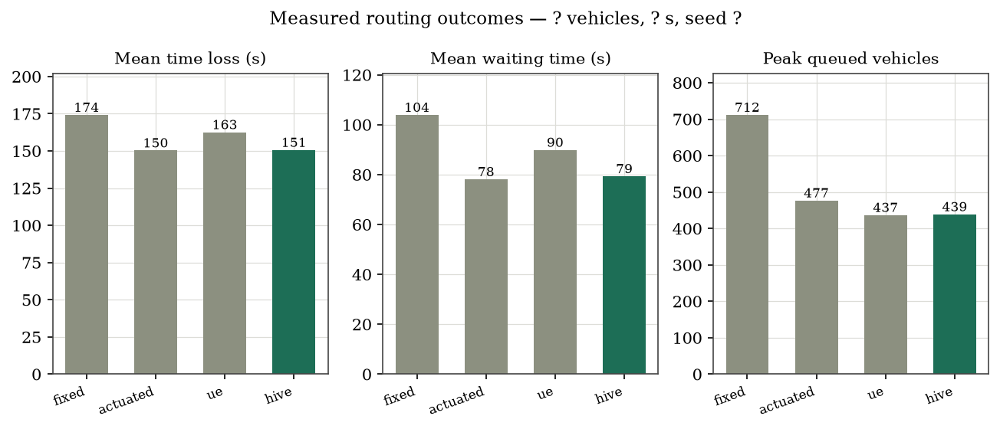<br/><sub><b>Fig 1.</b> All four rules on one network and one seed.</sub></td>
<td width="50%">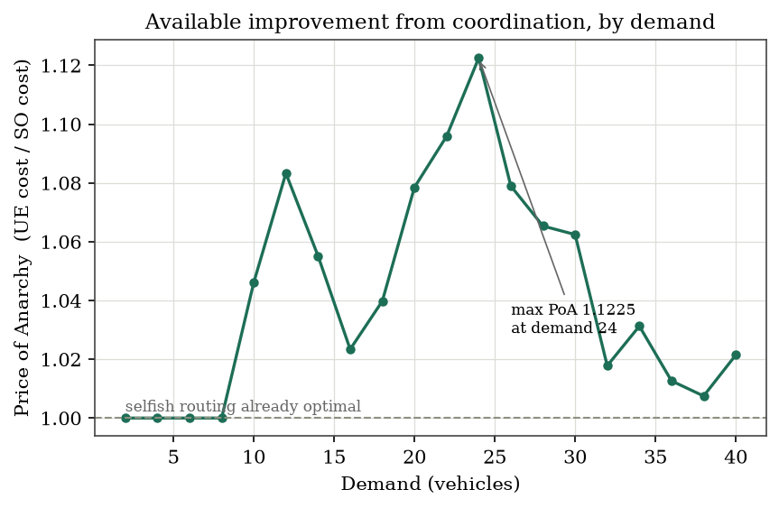<br/><sub><b>Fig 2.</b> Room for coordination by demand. At low demand selfish routing is already optimal.</sub></td>
</tr>
<tr>
<td>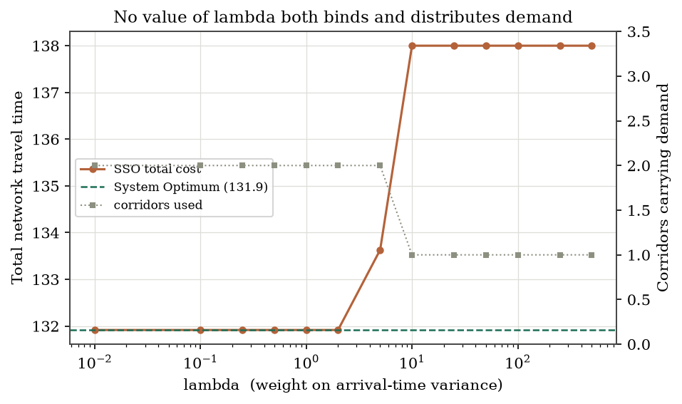<br/><sub><b>Fig 3.</b> The SSO negative result: no λ both binds and distributes.</sub></td>
<td>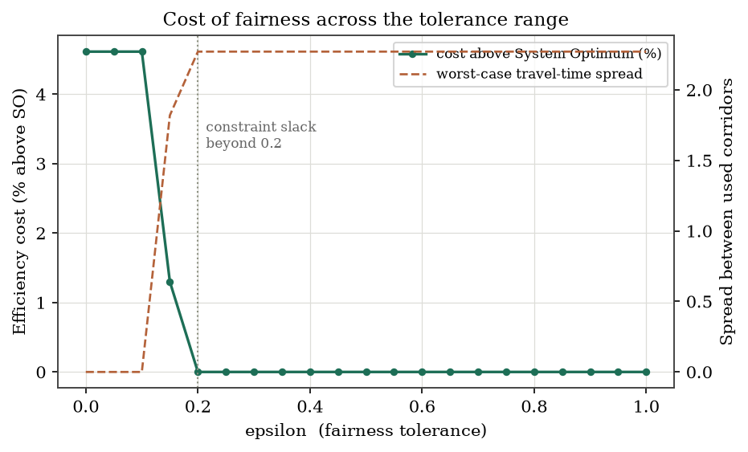<br/><sub><b>Fig 4.</b> The cost of fairness. The ε constraint goes slack beyond 0.2.</sub></td>
</tr>
<tr>
<td>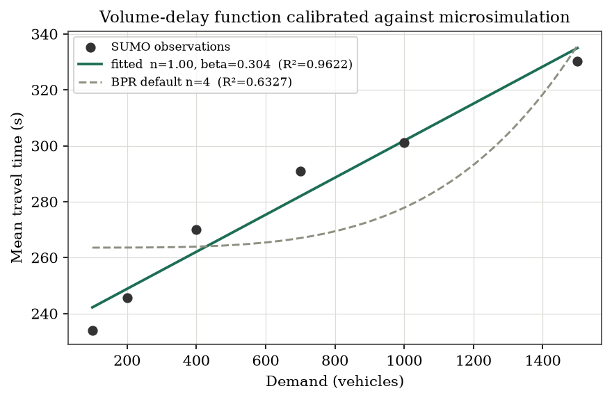<br/><sub><b>Fig 5.</b> Volume-delay curve fitted against SUMO observations.</sub></td>
<td>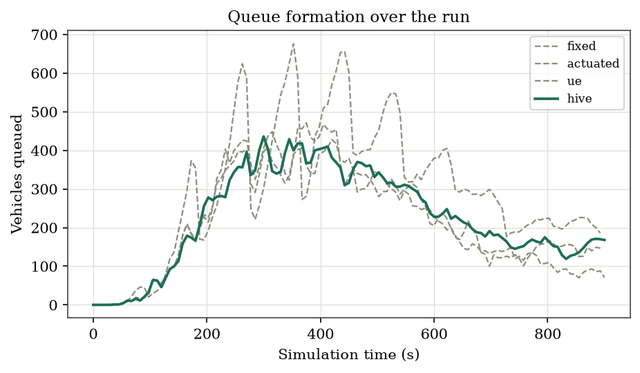<br/><sub><b>Fig 6.</b> Queue formation over the run, all four rules.</sub></td>
</tr>
<tr>
<td>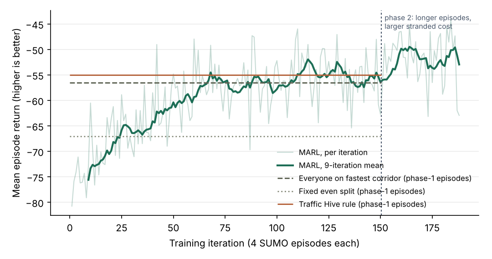<br/><sub><b>Fig 7.</b> MAPPO learning curve (split mode). Trained on the OSM network: returns rise from −78 and level off near −46 after about 75 iterations.</sub></td>
<td>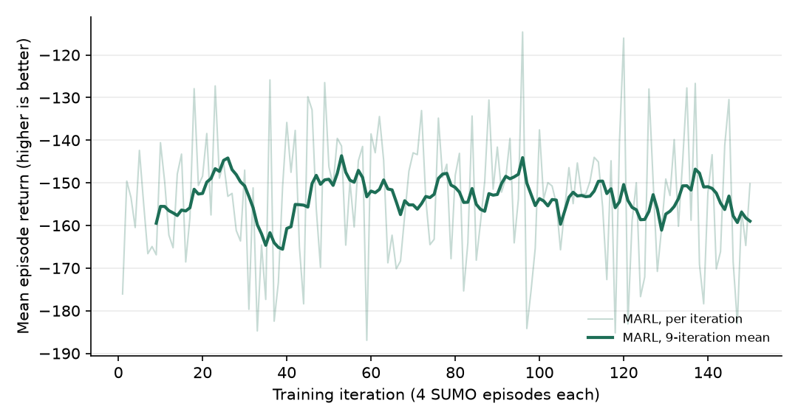<br/><sub><b>Fig 8.</b> Residual-mode learning curve. Flat over 150 iterations; evaluated, it ties the rule (table above).</sub></td>
</tr>
</table>

</details>

<p align="center">
  
</p>

### 📱 Hive Out: the driver's view

Numbers convince a panel. Watching your own car convinces everyone else. **Hive Out** (`hive_out/index.html`) is the split-screen demo: the simulation on the left, an obstacle editor, and a phone on the right with a 3D chase view of any vehicle you click.

<table>
<tr>
<td width="28%" valign="top" align="center">
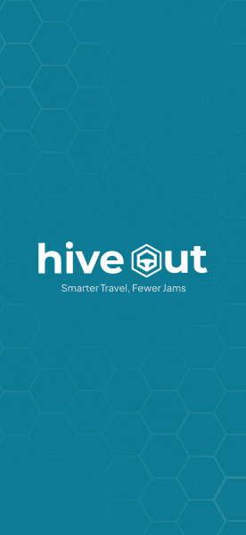
</td>
<td valign="top">

- 🚗 **Follow one driver, both ways.** Switch playback between *User equilibrium* and *Traffic Hive* and the followed vehicle stays selected, so you can compare the same person's trip under each rule.
- 🛺 **Drop real Manila obstacles.** Vendors in the curb lane, jeepneys loading mid-block, enforcers holding a junction, stalled cars, road work. They're applied in SUMO through TraCI, so they shape the trajectories instead of being painted on top. The hive is never told where they are; it only sees the slower roads.
- 📊 **Results & comparison.** Delay, waiting, peak queue, trip time, queue over time, synchronisation, fairness, and how evenly each rule spread traffic.
- ⚡ **Live or cached.** Pick a vehicle count and press **Simulate**. Runs are cached by parameter hash, so the demo itself is all instant replays.

```bash
python -m server.app --serve        # then open http://<host>:8000/hive-out/
```

</td>
</tr>
</table>

<!-- 🎥 Drop a screen recording here: drag an .mp4 or .gif into this file while editing on GitHub,
     and it will upload and paste a link. A 20-second clip of following one car under UE then Hive works best. -->

<details>
<summary><b>🛺 Obstacle types and what they do in SUMO</b></summary>
<br/>

| Type | Effect (light / moderate / heavy) |
|---|---|
| `vendor` | curb lane at 60 / 40 / 25 % of its limit; heavy closes it on multi-lane roads |
| `jeepney_stop` | passing jeepneys stop on the curb lane for 15 / 30 / 60 s |
| `enforcer` | green phases at the junction held 1.5 / 2 / 2.5× longer |
| `stalled` | curb lane closed |
| `roadwork` | curb lane closed, next lane at 50 % |

Coordinates are the local metre grid of `net.json` (origin at the network centre, y up). The easiest way to make a file is to place obstacles in Hive Out and press **Copy obstacles JSON**.

```bash
python -m pipeline.run_scenarios --scenario hive --vehicles 1000 --horizon 900 \
    --fcd-period 1.0 --obstacles examples/obstacles_espana_demo.json
python -m pipeline.pack --scenarios hive --baseline hive
```

With the 12 España demo obstacles, Hive's time loss was 237 s against UE's 253 s (−6 %), ahead in all 5 seeds.

</details>

<p align="center">
  
</p>

### 🛠️ How it fits together

The app never simulates. SUMO computes every trajectory ahead of time, the packer squeezes them into a flat binary, and the screens just play it back. That keeps SUMO as the validated engine, removes all runtime lag, and guarantees the numbers on screen match the numbers in the paper.

<p align="center">
  
</p>

**Quick start**

```bash
python -m venv .venv && source .venv/bin/activate
pip install -r requirements.txt          # eclipse-sumo ships the binaries
netconvert --version                     # sanity check

make all VEHICLES=1000 HORIZON=900 SEED=42
```

New to the setup? [`SETUP.md`](SETUP.md) walks through it with GitHub Desktop + VS Code, and [`SETUP-cli.md`](SETUP-cli.md) does it from the terminal. Both check every step before moving on.

<details>
<summary><b>⚙️ Pipeline stages</b></summary>
<br/>

| Stage | Command | Produces |
|---|---|---|
| 1. Build network | `make net` | `data/net/corridor.net.xml` |
| 2. Audit features | `make audit` | signal / crossing / sidewalk counts |
| 3. Run scenarios | `make runs` | `data/out/<scenario>/{fcd,tripinfo,summary}.xml` |
| 4. Pack assets | `make pack` | `app/assets/sim/{net.json,traj_*.bin,metrics.json}` |
| 5. Calibrate | `make calibrate` | `data/out/calibration.json` |
| 6. Figures | `make figures` | `figures/fig*.png` and `.pdf` |

**Stage 2 is a gate, not a formality.** Run `make audit` right after building the network. If it reports zero traffic lights or zero crossings, the OSM extract lacks the tags and no amount of frontend work will bring them back. Fix the extract first.

</details>

<details>
<summary><b>🚦 The four rules</b></summary>
<br/>

| Name | Signals | Routing | Role |
|---|---|---|---|
| `fixed` | static | shortest path | naive baseline |
| `actuated` | gap-based | shortest path | strong baseline |
| `ue` | gap-based | greedy rerouting | what navigation apps do |
| `hive` | gap-based | HPDM softmax | the proposed rule |

All four share one network, one demand file and one seed. Only the rule changes, and that isolation is what makes the comparison defensible. The corridor versions (`ue_corridor`, `hive_corridor`) assign over corridors precomputed by `pipeline/corridors.py`, which is both the formulation the manuscript describes and the reason thousands of vehicles stay tractable. There's also a `hive_sue` ablation: HPDM over plain travel time, kept to show that it degenerates into Stochastic User Equilibrium. `marl_corridor` swaps the HPDM formula for the learned MAPPO policy over the same corridors, and `hive_marl_corridor` keeps the formula but lets the trained agents shift its corridor prices each epoch.

</details>

<details>
<summary><b>🌐 Run-on-demand server</b></summary>
<br/>

The app sends a vehicle count and a duration; runs are cached on disk by parameter hash, so a repeated combination comes back instantly. Pre-warm what you plan to show so the demo is all cache hits, while the live path stays open for anything asked on the spot. The server prints its LAN address at startup.

```bash
python -m server.app --prewarm 250 500 1000 2000 --durations 60 --serve
```

| Endpoint | Purpose |
|---|---|
| `GET /health` | liveness, available scenarios, cache size |
| `POST /run` | start or retrieve a run; returns a key |
| `GET /status/{key}` | progress for the app's progress bar |
| `GET /assets/{key}/{file}` | `net.json`, `metrics.json`, `traj_*.bin` |
| `GET /runs` | cached runs, for a recent-runs picker |

</details>

<details>
<summary><b>📦 Trajectory binary format</b></summary>
<br/>

`traj_<scenario>.bin`, little-endian:

```
magic       4B    "THV1"
n_frames    u32
n_vehicles  u32
scale       f32   metres per quantisation unit
frame_dt    f32   seconds between frames
types       u8  * n_vehicles        0=car 1=jeepney 2=motorcycle
frames      n_frames * n_vehicles * (i16 x, i16 y, u8 speed_pct, u8 flags)
```

Absent vehicles are encoded `x = y = -32768`. `flags` bit 0 marks a stopped vehicle so the renderer can colour queues without recomputing anything. Roughly 6 bytes per vehicle per frame: 1,000 vehicles at 2 Hz over 15 minutes is about 11 MB per scenario.

`pack` also writes `signals_<scenario>.bin` (distance to the next stop line and the real signal state for every vehicle and frame), `vehicles_<scenario>.json` (trip metadata) and `obstacles_<scenario>.json`.

</details>

<details>
<summary><b>🔬 Analysis modules and calibration</b></summary>
<br/>

| Module | Library | Purpose |
|---|---|---|
| `pipeline/theory.py` | NumPy | Exhaustive enumeration of UE, SO, SSO and the constrained optimum; Price of Anarchy |
| `pipeline/calibrate.py` | SciPy | Fits BPR volume-delay parameters to SUMO observations by nonlinear least squares |
| `pipeline/evaluate.py` | NumPy | Replicated N-way runs (`--rules`): vehicle-hours, completion, delay, Gini, entropy, paired win rate |
| `pipeline/figures.py` | Matplotlib | Regenerates every manuscript figure from data files |
| `pipeline/marl_env.py` | TraCI | Multi-agent corridor environment: observations, cooperative reward, stranded-vehicle cost; `split` and `residual` action modes |
| `pipeline/marl.py` | NumPy | MAPPO trainer (shared actor, centralised critic, GAE, PPO clip), learning-curve plots, gradient check; `--mode residual` trains the rule-adjusting agents |

**Calibration.** `β = 0.15` and `n = 4` are US Bureau of Public Roads defaults. Fitting them against the OSM-built network (`data/out/calibration.json`, six demand levels from 100 to 1,500 vehicles) gave `β = 0.304` and `n = 1.0`, with R² 0.962 against 0.633 when `n` is fixed at 4. `n = 1.0` is the lower bound the fit allows, so the true exponent may be lower still: on this network travel time grows roughly linearly with load over the range we can observe. These are the values every Hive result above uses. (An earlier fit on a rebuilt copy of the network gave `n = 1.80`, `β = 0.384`; that copy is no longer used.) Re-run `make calibrate` after any network change and report the fitted values, not the defaults.

**Why no Unity?** 3D rendering was considered and dropped. The Skia canvas covers the visualisation on both web and mobile from one codebase, and a separate engine would have added a build dependency without changing any result.

</details>

<p align="center">
  
</p>

### 🗺️ Where we are

- [x] Network builder that keeps signals, crossings, sidewalks and layers
- [x] Feature audit
- [x] Demand generation and headless runner (fixed / actuated / ue / hive)
- [x] Packer: net geometry, quantised trajectories, precomputed metrics
- [x] Run-on-demand server with disk cache
- [x] Corridor routing on measured costs, replicated evaluation
- [x] Roadside obstacles and the Hive Out driver view
- [x] Multi-agent RL (MAPPO) corridor policy, evaluated on total vehicle-hours
- [x] Residual MARL (agents adjust the Hive rule's prices), trained 150 iterations
- [x] Evaluate `hive_marl_corridor` against `hive_corridor` on the held-out seeds
- [x] Retrain and re-evaluate MARL on the OSM-built network, 10 seeds
- [ ] MARL chapters (methodology and results) finalised in the manuscript
- [ ] 30-seed paired test of Hive + MARL against the rule (is the 1 % gain with obstacles real?)
- [ ] MARL results shown in the app's results panel

### 🤝 The swarm behind it

Built by **Amiere Miranda** and **Janine B. Garsota**, advised by **Prof. Vivien A. Agustin**, at Pamantasan ng Lungsod ng Maynila.

If you're working on traffic, cooperative routing, or anything that helps a city move a little more kindly, we'd love to hear from you.

<p align="center">
  <a href="https://github.com/Alfheim31"></a>
  <a href="https://linkedin.com/in/miranda31"></a>
  <a href="https://amieremiranda-dev-portfolio.vercel.app"></a>
</p>

<p align="center">
  
</p>

<p align="center"><sub>Every animated card above is drawn from the repo's own data by <code>python docs/readme/generate.py</code>. Re-run it after new results.</sub></p>
